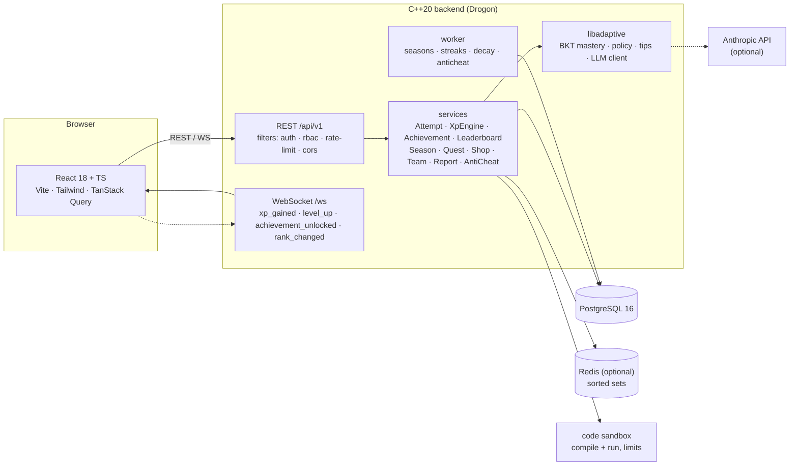
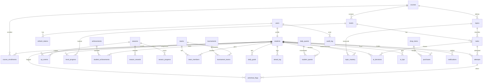

# Lumina — Gamified Learning System · Архитектура

> «Оқу — ойын» · Учебные задания как игра: уровни, XP, достижения, рейтинги, сезоны.

Lumina — полноценная LMS-платформа с геймификацией. Вся игровая логика
(XP, уровни, серии, достижения, рейтинги, экономика) считается **только на
сервере** и хранится в PostgreSQL. Клиент — тонкий React-клиент, который
отображает состояние и отправляет ответы.

## 1. Общая схема



Принципы:

1. **Server-authoritative.** Ни один XP-балл, звезда или место в рейтинге не
   приходит с клиента. Клиент присылает только `answer` + `attempt_token`.
2. **Транзакционность.** Попытка → проверка → `xp_events` → обновление
   студента → достижения → прогресс уровня выполняются в одной транзакции с
   `SELECT ... FOR UPDATE` по строке студента.
3. **Идемпотентность.** `attempt_token` уникален; повторная отправка
   возвращает исходный результат без повторного начисления.
4. **Объяснимость AI.** Каждое решение политики пишется в `ai_decisions`
   вместе с признаками и человекочитаемым объяснением.
5. **Три языка.** Контент и серверные тексты — kk / ru / en, выбор по
   `Accept-Language` или профилю.

## 2. Структура репозитория

```
backend/
  CMakeLists.txt              # C++20, Drogon, libpqxx, nlohmann, libsodium…
  src/
    core/                     # config, log, errors, time, uuid, crypto, json
    db/                       # pool, transaction, migrator
    domain/                   # сущности и DTO
    repo/                     # SQL-репозитории (prepared statements)
    services/                 # бизнес-логика (XP, достижения, рейтинги…)
    ai/                       # libadaptive: BKT, policy, tips, LLM
    sandbox/                  # запуск кода с лимитами
    http/                     # контроллеры Drogon + filters
    ws/                       # WebSocket hub
    jobs/                     # worker: сезоны, серии, decay, античит
  tools/                      # migrator, seeder
  tests/                      # GoogleTest (unit + integration)
db/migrations/*.up.sql|down.sql
seeds/                        # JSON-контент: курсы, достижения, магазин…
frontend/                     # React 18 + TS + Vite
docker/                       # Dockerfile, compose
docs/                         # архитектура, решения, ER, API, демо
```

## 3. Слои backend

| Слой | Ответственность |
|------|-----------------|
| `http` | маршрутизация, валидация DTO, коды ошибок, сериализация |
| `filters` | JWT-auth, RBAC, rate-limit (token bucket), CORS, request-id |
| `services` | правила игры, транзакции, вызовы движков |
| `ai` | mastery-модель, политика следующего задания, советы, прогнозы |
| `repo` | параметризованный SQL, блокировки, пагинация |
| `jobs` | фоновые задачи (закрытие сезонов, сброс целей, decay mastery) |

## 4. Модель данных (ER)



Полная DDL — `db/migrations/0001..0006`, представления — `db/views/`.

## 5. XP-экономика

```
XP = base_xp
   × difficulty_multiplier(d)      # 0.8 + 0.12·d
   × accuracy_factor(score)        # 0.4 + 0.6·score
   × speed_factor(time, limit)     # 0.85..1.15
   × streak_multiplier(streak)     # 1 + min(0.5, 0.05·streak)
   × (1 − hint_penalty)            # 0.15 за подсказку, max 0.45
   × repeat_decay                  # 0.5 при повторе задания
```

* `xp_to_next(level) = round(100 × level^1.5)`.
* Бонусы: первое задание дня, идеальный уровень, комбо из 5/10, босс,
  дневная цель, квесты.
* `xp_events` — append-only журнал с `balance_after` и `season_id`.
* Монеты начисляются вместе с XP и тратятся в магазине.

## 6. AI-модуль

* **MasteryModel (BKT + Elo).** Для пары (студент, тема): `mastery ∈ [0,1]`,
  `confidence`, `streak_correct/wrong`, время последнего касания. После
  попытки — Bayesian update, затем забывание по экспоненте.
* **NextTaskPolicy.** Смесь: 70 % — зона ближайшего развития (ожидаемый
  успех 60–80 %), 20 % — слабая тема (spaced repetition), 10 % — вызов.
  Успех ≥ 3 подряд → сложность +1; ошибка → −1 с восстановлением; ≥ 3 ошибок
  или ≥ 60 % ошибок за 10 попыток → понижение + совет + мини-урок.
* **Объяснимость.** Каждое решение → `ai_decisions.features` + `reason_code`
  + текст на трёх языках, эндпоинт `/ai/explain/{id}`.
* **LLM (опционально).** Anthropic Messages API через Drogon HttpClient при
  наличии `ANTHROPIC_API_KEY`; строгая JSON-схема, валидация, самопроверка,
  кэш, лимиты. Без ключа — шаблонные генераторы и банк заданий.

## 7. Безопасность

* Argon2id (libsodium) для паролей; JWT HS256 access (15 мин) + refresh
  (30 дней) с ротацией и хранением хэша refresh-токена.
* RBAC: `student` / `teacher` / `admin`, проверка на каждом маршруте.
* Rate limiting: token bucket per IP + per user (in-memory, Redis-ready).
* SQL только через параметризованные запросы libpqxx.
* Признаки античита: слишком быстрый ответ, серия одинаковых ответов у
  разных студентов, аномальная точность; флаг `suspicious` снижает XP до 0.
* Песочница: отдельный процесс, лимиты времени/памяти, без сети.
* `audit_log` для действий преподавателей и админов.

## 8. Реальное время

WebSocket `/ws?token=...` — события `xp_gained`, `level_up`,
`achievement_unlocked`, `rank_changed`, `quest_completed`, `season_ending`.
Hub хранит соединения по `user_id` и рассылает из сервисов.

## 9. Локальный запуск

```bash
cmake -S backend -B build -G Ninja -DCMAKE_BUILD_TYPE=Release
cmake --build build
./build/lumina_migrator            # миграции
./build/lumina_seeder              # контент + демо-данные
./build/lumina_server              # http://127.0.0.1:8080
cd frontend && npm install && npm run dev
```

Подробнее — `README.md`, `docs/DEMO.md`.
