# Data model

The schema is created by five migrations and two view migrations; every table
has a primary key, foreign keys, `CHECK`/`UNIQUE` constraints and timestamps.
All identifiers are UUIDs generated by the application; `xp_events` and
`leaderboards` use `bigserial` for append-only history.

```mermaid
erDiagram
    users ||--|| students : "profile"
    users ||--o{ refresh_tokens : "rotating sessions"
    users ||--o{ audit_log : "actor"

    courses ||--o{ levels : "8 levels"
    courses ||--o{ topics : "tags"
    courses ||--o{ course_enrollments : "enrolled"
    students ||--o{ course_enrollments : "enrolls"
    levels ||--o{ tasks : "10 tasks"
    topics ||--o{ tasks : "classifies"
    levels ||--o{ level_progress : "student progress"
    students ||--o{ level_progress : "tracks"

    students ||--o{ attempts : "answers"
    tasks ||--o{ attempts : "attempted"
    attempts ||--o{ anticheat_flags : "flagged by"

    students ||--o{ xp_events : "earns"
    students ||--o{ student_achievements : "unlocks"
    achievements ||--o{ student_achievements : "awarded"

    seasons ||--o{ season_rewards : "tiers"
    seasons ||--o{ season_progress : "season xp"
    seasons ||--o{ xp_events : "scopes"

    teams ||--o{ team_members : "roster"
    students ||--o{ team_members : "joins"
    tournaments ||--o{ tournament_teams : "includes"
    teams ||--o{ tournament_teams : "competes"

    students ||--o{ daily_goals : "goal of the day"
    students ||--o{ streak_log : "daily activity"
    students ||--o{ student_quests : "quests"
    daily_quests ||--o{ student_quests : "instantiated"

    topics ||--o{ topic_mastery : "BKT state"
    students ||--o{ topic_mastery : "mastery"
    students ||--o{ ai_decisions : "adaptive picks"
    tasks ||--o{ ai_decisions : "chosen"
    students ||--o{ ai_tips : "advice"

    students ||--o{ purchases : "buys"
    shop_items ||--o{ purchases : "sold"
    students ||--o{ inventory : "owns"
    shop_items ||--o{ inventory : "item"
    users ||--o{ notifications : "receives"
```

## Tables

| Table | Purpose | Key constraints |
|---|---|---|
| `users` | accounts, roles (`student/teacher/admin`), locale | unique lower(email) where not deleted |
| `refresh_tokens` | rotated refresh sessions | unique token hash |
| `students` | game profile: XP, level, coins, streak, league, goal | 1:1 with users |
| `courses` | trilingual course catalog | unique slug |
| `topics` | course topics, parent tree | unique (course_id, code) |
| `levels` | ordered levels, unlock rules JSONB, boss flag | unique (course_id, order_no) |
| `tasks` | 10 types, payload/answer_key JSONB, hints | type CHECK, difficulty 1–10 |
| `course_enrollments` | enrollment + progress % | PK (student, course) |
| `attempts` | answers, score, time, hints, suspicious, stored response | unique attempt_token |
| `level_progress` | stars, best accuracy, completion | PK (student, level) |
| `xp_events` | append-only XP journal | `balance_after`, season_id, course_id |
| `achievements` | 45 declarative rules + i18n titles | unique code |
| `student_achievements` | awarded achievements | PK (student, achievement) |
| `seasons`, `season_rewards`, `season_progress` | seasonal XP race and tiers | unique (season, tier), PK (season, student) |
| `leaderboards` | snapshots for ranks and ▲▼ deltas | indexes by scope/period |
| `teams`, `team_members` | teams, one team per student | unique (student_id) in members |
| `tournaments`, `tournament_teams` | team tournaments and scores | PK (tournament, team) |
| `daily_goals`, `streak_log` | daily goal and activity calendar | PK (student, date) |
| `daily_quests`, `student_quests` | 30 quest templates and assignments | unique (student, quest, date) |
| `shop_items`, `purchases`, `inventory` | economy | unique code |
| `topic_mastery` | BKT/Elo state per topic | PK (student, topic) |
| `ai_decisions` | explainable adaptive decisions | features + explanation JSONB |
| `ai_tips` | generated tips | |
| `ai_tip_templates` | 60 seeded templates | unique code |
| `anticheat_flags` | suspicious attempts | status workflow |
| `notifications` | in-app notification center | |
| `audit_log` | staff/admin actions | |

## Views (`0006_views`)

* `v_course_progress` — completed levels, stars, progress %.
* `v_topic_stats` — attempts/accuracy/avg time per topic.
* `v_daily_xp` — XP per local day.
* `v_weekly_leaderboard` — weekly XP per student.
* `v_teacher_course` — course-level aggregates for the teacher panel.

## Indexes

Leaderboards: `students(total_xp DESC)`, `students(league, total_xp DESC)`,
`xp_events(created_at DESC)`, `xp_events(course_id, created_at)`,
`season_progress(season_id, season_xp DESC)`.
Attempts: `(student_id, created_at DESC)`, `(task_id, student_id)`,
`(created_at DESC)`.
Content: `tasks(level_id, sort_order)`, `tasks(topic_id, difficulty)`,
`topics(course_id)`, `levels(course_id, order_no)`.
